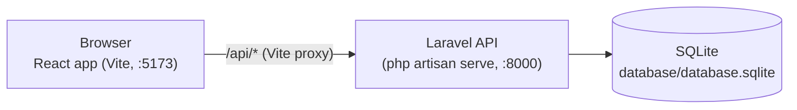
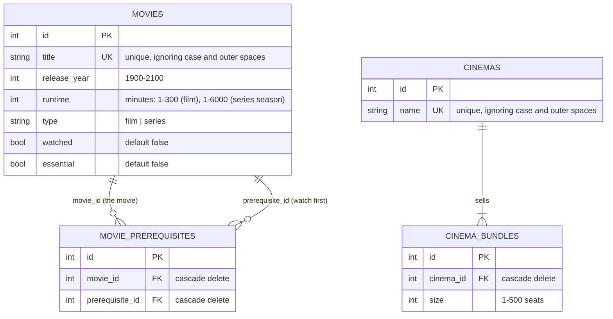
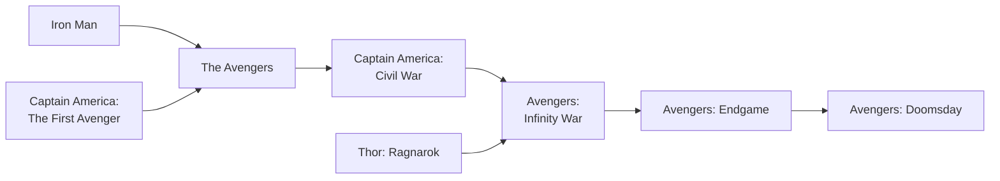

# Doomsday Ready

A small full-stack app for planning an MCU rewatch before *Avengers: Doomsday* and booking an
opening-night watch party.

- **Backend:** Laravel 12 (PHP 8.2), SQLite, JSON API under `/api`
- **Frontend:** React 19 + Vite 6 (plain JavaScript), icons from `lucide-react`

## How it fits together



The Vite dev server forwards every `/api` request to Laravel, so the browser only talks to one origin.
The target can be changed with the `API_TARGET` environment variable (default `http://127.0.0.1:8000`).

## Setup

### With Docker (one command)

Needs Docker with Docker Compose. From the repo root:

```bash
docker compose up --build
```

- App: http://localhost:5173 · API: http://localhost:8000/api
- On the first start the database is created and filled with the sample data (8 movies, 4 cinemas).
  It lives in the Docker volume `db-data`, so your changes are kept between restarts.
- Stop: `docker compose down`. Stop and delete the data: `docker compose down -v`.

Two containers: `backend` (PHP 8.2, Laravel's built-in server) and `frontend` (Node 22, Vite dev server,
with `API_TARGET=http://backend:8000` so its `/api` proxy reaches the backend container).

### Without Docker

Needs PHP 8.2+ (with the `pdo_sqlite` extension), Composer and Node.js 18+ (built with PHP 8.2.12 and Node 22.14).

**Backend** (first terminal):

```bash
cd backend
composer install
cp .env.example .env          # Windows cmd: copy .env.example .env
php artisan key:generate
touch database/database.sqlite   # PowerShell: New-Item database/database.sqlite
php artisan migrate --seed
php artisan serve             # http://127.0.0.1:8000
```

`--seed` loads the PDF's 8 sample movies and 4 sample cinemas (A: 1, 3, 4 · B: 2, 5 · C: 6, 9, 20 · D: 4, 6).
To start over: `php artisan migrate:fresh --seed`.

**Frontend** (second terminal):

```bash
cd frontend
npm install
npm run dev                   # http://127.0.0.1:5173
```

**Tests:** `cd backend && php artisan test`. They cover all 8 expected results from the assessment
(4 rewatch, 4 booking) plus validation, 404/405/409 and the seeders.

## Data model



- **Prerequisites** are a self-referencing many-to-many on `movies`: one row in `movie_prerequisites`
  means "watch `prerequisite_id` before `movie_id`". Each pair is unique.
- **Bundles** are their own table (one row per size, `cinema_id` + `size` unique), so a cinema has
  1 to 10 different sizes.
- All tables also have `created_at` / `updated_at`. Laravel's default tables are left in place:
  `cache` / `cache_locks` hold the lock used by the cycle check; `users`, `sessions` and `jobs` are unused.

### Sample data (from the assessment)



An arrow means "watch this first". Making Endgame a prerequisite of Iron Man would close a loop, so the
API answers `409 CIRCULAR_DEPENDENCY`.

## API

All routes are under `/api` and send and receive JSON. Field names are snake_case, except the
spec's `groupSize` query parameter.

| Method and path | What it does |
|---|---|
| `GET /movies` | All movies with their `prerequisites` |
| `POST /movies` | `title`, `release_year`, `runtime`, optional `type`, `watched`, `essential`, `prerequisite_ids` → `201` |
| `PATCH /movies/{id}` | Any of the fields above. `prerequisite_ids` replaces the whole list. A loop gives `409` |
| `GET /movies/{id}/rewatch-order` | `{movie, order[], watched_count, total_count, remaining_runtime}`. Add `?essentials=1` for essential titles only |
| `POST /movies/load-mcu` | *Extra:* loads a full MCU data set (83 titles). Can be run again; watched ticks are kept |
| `GET /cinemas` | All cinemas with their `bundles`, sorted by size |
| `POST /cinemas` | `name`, `bundle_sizes` (1-10 different whole numbers, 1-500 each) → `201` |
| `GET /cinemas/{id}/booking?groupSize=6` | `{cinema, group_size, possible, total_bundles, bundles[{size, count}]}` |

Errors always have the same shape:

```json
{ "error": { "code": "VALIDATION_ERROR", "message": "...", "fields": { "title": ["..."] } } }
```

Codes: `422 VALIDATION_ERROR` (with `fields`), `404 NOT_FOUND`, `405 METHOD_NOT_ALLOWED`,
`409 CIRCULAR_DEPENDENCY`, `500 SERVER_ERROR`.

## How the two features work

**Cycle check (feature 1).** Before saving new prerequisites for movie M, an iterative depth-first
search starts from each new prerequisite and follows *their* prerequisites. If it ever reaches M, the
change would make M depend on itself, so it is rejected with `409`. The check and the write run under
one lock (the write itself in a database transaction), so two requests at the same time cannot build a
loop together.

**Rewatch order (feature 1).** All prerequisite links are loaded once. A recursive depth-first search
from the target visits each prerequisite, first visiting *its* prerequisites, and adds a movie to the
list only after all of its own prerequisites are in it (post-order). A visited set makes sure each movie
appears once. The target itself is left out. Links are followed in order of release year, so the list
reads roughly in release order.

**Booking quote (feature 2).** Dynamic programming over group sizes 0…N: `best[n]` is the fewest
bundles that add up to exactly `n` seats, `last[n]` is the bundle used last to get there. For each `n`,
every bundle size `s ≤ n` is tried: `best[n - s] + 1`. Walking back through `last[]` from N gives the
count per size. If `best[N]` was never reached, the answer is "not possible". Time O(N × sizes).

## Assumptions

Where the assessment left a choice open, I picked the following:

- "Release year and runtime in minutes: 1-300" is read as: runtime is 1-300 minutes. Release year must be
  between 1900 and 2100.
- Titles and cinema names are unique ignoring upper/lower case and spaces at the start or end
  ("iron man " counts as a duplicate of "Iron Man") → `422`. Case is compared by SQLite's `LOWER()`,
  which only folds A-Z, so "Élan" and "élan" count as different titles.
- Invalid input is `422 VALIDATION_ERROR` with a message per field.
- Prerequisites are sent as movie ids. An unknown or repeated id → `422`. A movie listed as its own
  prerequisite → `409 CIRCULAR_DEPENDENCY` (it depends on itself "directly").
- `PATCH` with `prerequisite_ids` replaces the whole list; `[]` removes all prerequisites.
- Repeated bundle sizes for one cinema (`[2, 2]`) → `422`, since the sizes must be different.
- `groupSize` must be a whole number from 1 to 10,000, otherwise `422`.
- "Not possible" is a normal answer (`200` with `"possible": false`), not an error.
- When two answers use the same number of bundles, larger bundles are preferred. Bundles are listed
  largest first.
- The assessment gives no runtimes, so the sample data uses the real ones. *Avengers: Doomsday* is not
  out yet, so its runtime (150 min) is a placeholder.
- There are no users or logins; the assessment does not ask for them, so everyone shares one list.

### Extras beyond the assessment

- **TV seasons:** a movie can have `type: series` (one season per entry). A whole season is longer
  than 300 minutes, so seasons may be up to 6000 minutes. Films keep the 1-300 limit.
- **Essentials:** an `essential` flag and `?essentials=1` on the rewatch order. In the full MCU data,
  "essential" means the 15 titles Disney+ lists to watch before *Doomsday*.
- **Full MCU data:** the "Load full MCU data" button (`POST /movies/load-mcu`) adds 83 titles: the MCU
  films, the Disney+ shows and specials, Fox's X-Men films and Sony's Spider-Man films. Show runtimes are
  approximate.
- **Graph view:** a fourth tab draws the prerequisite graph. Clicking a movie highlights everything it
  depends on and everything that depends on it.

## How I used AI

I used **Claude (Claude Code)** as a helper throughout the project.

**Written by me:**
- The rewatch order logic (`rewatchOrder()` and the recursive `visit()` in `MovieController`), in full.
- The cycle check design: an iterative depth-first search with a stack and a visited set, written as
  pseudocode and improved over several review rounds. Claude translated it into PHP.
- The core loop of the booking table.
- The `Movie` model, the first migrations and `POST /movies`.
- The choice of features, tabs, colours and design direction of the frontend.

**Done by Claude, at my request, and reviewed by me:**
- Project setup, schema fixes, models, the remaining endpoints, validation and the shared error format.
- Seeders, research for the full MCU data set, and the automated tests.
- Parts of the React frontend.
- The Docker Compose setup.
- This README.

No library was used to solve the cycle check, the rewatch order or the booking quote.
